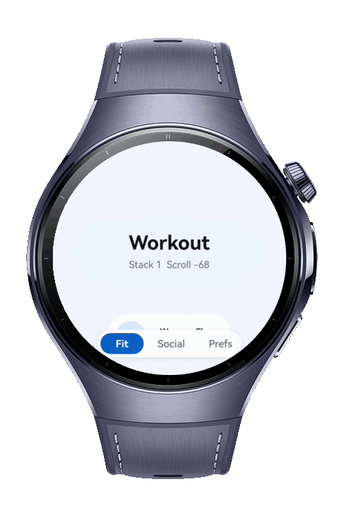

> **Note:** To access all shared projects, get information about environment setup, and view other guides, please visit [Explore-In-HMOS Index](https://github.com/Explore-In-HMOS/hmos-index).

# How to Build MultiNav on HarmonyOS

This app is a wearable multi-stack navigation that uses `MultiNavPathStack` to manage parallel navigation stacks with independent back-stack histories, `MultiNavigation` to host stack-based navigation content, `NavPushPathHelper` to push named routes with parameters, `AtomicServiceNavigation` to provide the wearable atomic service shell, and `ArcList` to present round-screen friendly list content.

# Preview

<div>
  
</div>

# Use Cases

- Create independent wearable navigation stacks with `MultiNavPathStack`
- Host stack content with `MultiNavigation`
- Push named detail routes with `NavPushPathHelper`
- Pass route parameters into detail pages
- Preserve back-stack history for Fit, Social, and Prefs
- Preserve list scroll position when switching tabs
- Use `ArcListItem.autoScale` for wearable-friendly arc scrolling
- Wrap the app with `AtomicServiceNavigation` for atomic service navigation context

# Technology

## Stack

- **Languages**: ArkTS, ArkUI
- **Frameworks**: HarmonyOS SDK 6.1.1(24)
- **Tools**: DevEco Studio 6.1.1
- **Libraries**:
    - `@kit.ArkUI`
    - `@kit.ArkTS`
    - `@kit.AbilityKit`
    - `@ohos.arkui.advanced.MultiNavigation`
    - `@ohos.atomicservice.NavPushPathHelper`
    - `@ohos.atomicservice.AtomicServiceNavigation`
    - `@ohos.arkui.ArcList`

# Directory Structure

```
entry/
|-- src/
|   |-- main/
|   |   |-- module.json5
|   |   `-- ets/
|   |       |-- entryability/
|   |       |   `-- EntryAbility.ets
|   |       |-- entrybackupability/
|   |       |   `-- EntryBackupAbility.ets
|   |       `-- pages/
|   |           `-- Index.ets
```

# Constraints and Restrictions

## Supported Device

* Huawei Watch 5
* HarmonyOS wearable emulator

# License

**How to Build Wearable Multi-Stack Navigation** is distributed under the terms of the MIT License. See the [LICENSE](LICENSE) for more information.
